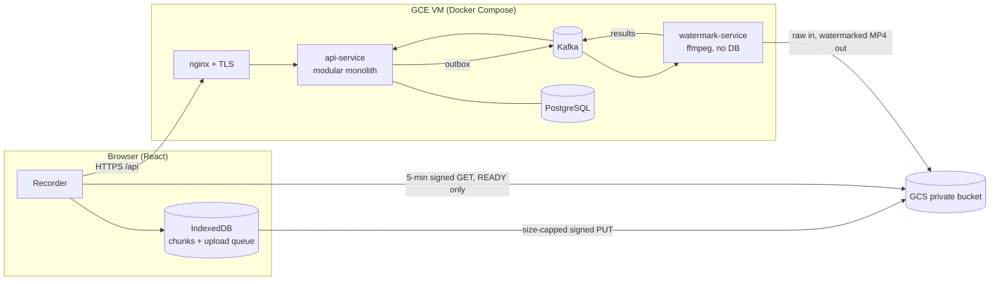

# VMS: Parcel Video Recorder with Watermarking

Operators record a 1–2 minute webcam video per parcel, identified by a **Tracking ID**. Videos are
uploaded straight to Google Cloud Storage and a separate microservice stamps a logo in the
bottom-right corner with ffmpeg. Recording never needs a click: **scanning a Tracking ID starts
recording, scanning the next one saves it and starts the next clip.** Nothing is lost when the
network drops.

- **Live URL:** see [REVIEWER-GUIDE.md](REVIEWER-GUIDE.md) (also has the test credentials and a 2-minute test script)
- **Stack:** React 19 + TypeScript · Spring Boot 4.1 (Java 17) · PostgreSQL 16 · Apache Kafka 4 (KRaft) · ffmpeg · GCS · Docker · GCP Compute Engine

## Architecture



The three flows:

1. **Upload:**
   1. Scan a Tracking ID; the video is recorded locally (1 s chunks in IndexedDB).
   2. On Stop, `POST /videos` returns a signed URL capped by content type and size.
   3. The browser uploads with a `PUT` straight to GCS.
   4. `/complete`: the API verifies the object, then records `UPLOADED` and an outbox event in one transaction.
2. **Processing:**
   1. The outbox relay publishes `video.uploaded.v1`.
   2. The watermark service probes the video, runs ffmpeg and verifies the output.
   3. It writes `videos/…mp4` (create-only) and deletes the raw file.
   4. A result event goes back; the API sets READY.
3. **Recovery:**
   - **Network down:** the clip stays on the device and uploads with backoff when the network returns.
   - **Kafka down:** the outbox holds the event.
   - **Processing error:** retry topics (10 s / 60 s / 300 s), then the dead-letter topic and FAILED, then retry from the preserved raw file.

## Repository layout

| Path | What |
| --- | --- |
| `api-service/` | Auth (password + Google, JWT + rotating refresh cookie), videos, signed URLs, outbox, result consumer |
| `watermark-service/` | Kafka consumer with retry topics + DLT, ffmpeg pipeline (Template Method), storage adapters |
| `frontend/` | Recorder (state machine), camera handling, offline upload queue, videos list |
| `infra/` | Docker Compose (local + prod), nginx, Terraform for GCP (`infra/terraform`), deploy / rollback scripts, Cloud Build |
| `docs/` | Requirements, HLD, LLD, API, security, deployment runbook, ADRs, event schemas |

> **Step-by-step instructions for running locally and on Google Cloud are in
> [docs/00-Run-Guide.md](docs/00-Run-Guide.md)** (prerequisites, checks, troubleshooting and teardown).
> **How to use the app** (recording, uploads, videos, admin) is in [docs/USER-GUIDE.md](docs/USER-GUIDE.md).

## Quick start (local, ~5 minutes)

Prerequisites: Docker Desktop. Java 17, Maven and Node 24 are only needed to run tests outside Docker.

```bash
cp .env.example infra/.env        # replace the placeholder values (openssl rand -base64 48)
docker compose -f infra/docker-compose.yml --env-file infra/.env up -d --build
open http://localhost:8088        # sign in with VMS_DEMO_USER_EMAIL / VMS_DEMO_USER_PASSWORD
```

Locally, storage is a signed-URL filesystem emulator, so no cloud account is needed. `http://localhost` is a secure origin, so the camera works without HTTPS.

## Tests

```bash
(cd api-service && mvn verify)        # 66 tests incl. Testcontainers (Postgres + Kafka) + format check
(cd watermark-service && mvn verify)  # 24 tests incl. real ffmpeg on 60 s / 120 s 720p clips
(cd frontend && npm ci && npm run lint && npm test && npm run build)   # 39 tests
```

## Deploy to Google Cloud

Run these from Cloud Shell, which has `gcloud` and `terraform`. Step by step: [docs/00-Run-Guide.md](docs/00-Run-Guide.md) Part B. Operations: [docs/05-Deployment-Runbook.md](docs/05-Deployment-Runbook.md).

```bash
cp infra/terraform/terraform.tfvars.example infra/terraform/terraform.tfvars   # set project_id + letsencrypt_email
terraform -chdir=infra/terraform init && terraform -chdir=infra/terraform apply
./infra/scripts/deploy.sh                 # Cloud Build -> Artifact Registry -> VM, HTTPS on <ip>.sslip.io
./infra/scripts/deploy.sh --rollback      # previous image tag
```

## Key design decisions

| Decision | Why |
| --- | --- |
| Modular monolith + one microservice | Video + outbox are written in one ACID transaction; ffmpeg is CPU-heavy, isolated and scales on its own |
| Watermark service owns **no database** | It talks only through Kafka and GCS, so the services can be deployed and changed independently |
| Direct-to-GCS signed upload, size in the signature | Video bytes never touch the API; the signature binds object, method, content type, expiry and size |
| Transactional outbox | No dual write: a Kafka outage can't lose an event |
| Retry topics + DLT, retryable vs permanent | Non-blocking retries; corrupt input isn't retried pointlessly |
| Raw → final, then delete raw | Nothing destructive until success; retries start from the clean original; only the watermarked video remains |
| Playback only when READY | Unwatermarked video is never served from the cloud |
| Offline-first browser queue | IndexedDB chunks every 1 s, backoff + jitter, real connectivity probe, per-user jobs, crash recovery |
| JWT in memory + httpOnly rotating refresh cookie | No token for XSS to steal; refresh reuse revokes the session family |
| Single VM + Compose on GCP | Cheapest setup that runs Kafka; same containers locally and in the cloud; no key files |

Each decision has a one-page ADR in [docs/adr](docs/adr).

## Trade-offs and future work

**Deliberate trade-offs**
- **Single VM, single Kafka broker (RF=1).** This is a single point of failure, acceptable for the assignment.
- **Status polling, not SSE/WebSockets.** It's simple, works through any proxy, and polling stops once nothing is pending.
- **HS256 JWT signed with a shared secret.** With more than one token issuer you'd switch to asymmetric keys and a JWKS endpoint.
- **Spring CSRF tokens are disabled on purpose.** Access tokens are sent in a header that other sites can't make the browser attach. The only cookie, the refresh token, is `SameSite=Strict`, scoped to the auth path, and its endpoints require a custom header and an allowed Origin.
- **Resumable uploads in 4 MiB pieces.** After a network drop only the unconfirmed piece is re-sent. The API opens the storage session with the exact declared size; `VMS_UPLOAD_PROTOCOL=SIMPLE` switches back to one size-capped signed PUT. Recording-time (progressive) upload is not implemented.
- **The Kafka listener blocks while ffmpeg runs.** That's safe for clips of 2 minutes or less (1 record per poll, 5-minute poll interval, 3-minute ffmpeg timeout). Long videos would need pause/resume or a job queue with leases.
- **IndexedDB data isn't encrypted on the device.** Mitigations: jobs are filtered per user, and local copies are deleted once the video is READY.

**Production path**
- **API:** Cloud Run.
- **Watermark workers:** a managed instance group or GKE, autoscaled on Kafka consumer lag.
- **Data:** Cloud SQL with high availability, and Managed Kafka with RF=3.
- **Playback:** CDN with signed cookies.
- **Observability:** OpenTelemetry tracing, plus SLO alerts on dead-letter-topic size, consumer lag and outbox backlog.

**Scaling to 500 stations**
- That's about 250 clips/min. Measured throughput is about 12 s per 2-minute clip per worker, so about 50–100 workers.
- Kafka partitions must be at least the number of workers.
- GCS absorbs the upload load directly; the API never sees the video bytes.

**Next with more time**
- Progressive upload during recording.
- Stale-upload reconciler.
- Micrometer metrics.
- Testcontainers integration tests.
- Playwright end-to-end tests with a fake camera.
- Remote Terraform state in GCS for team use.
