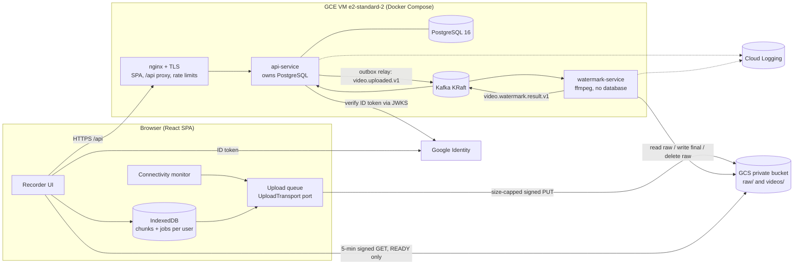
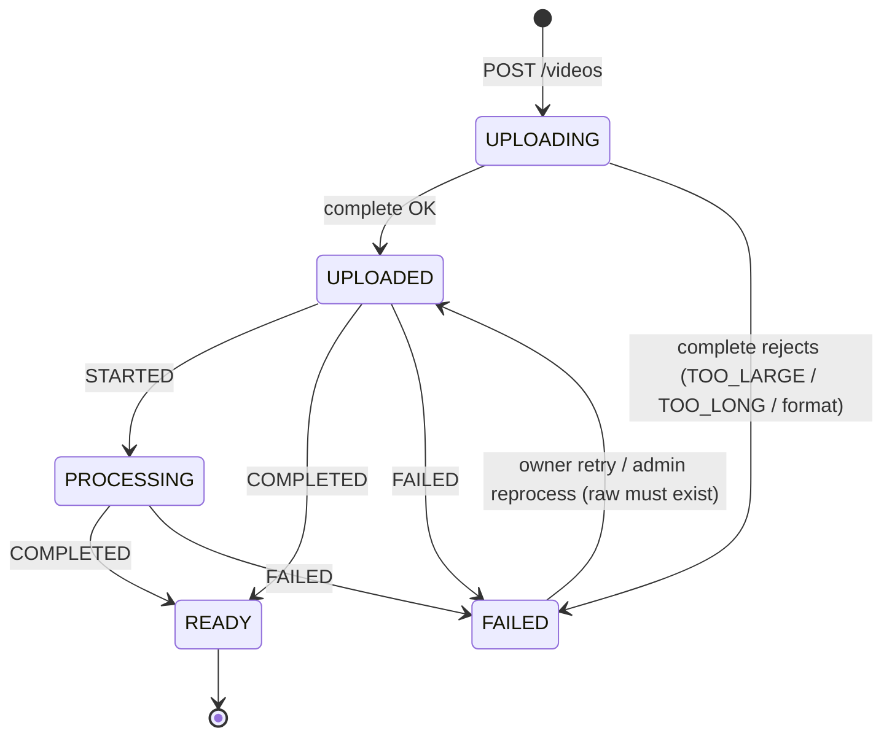
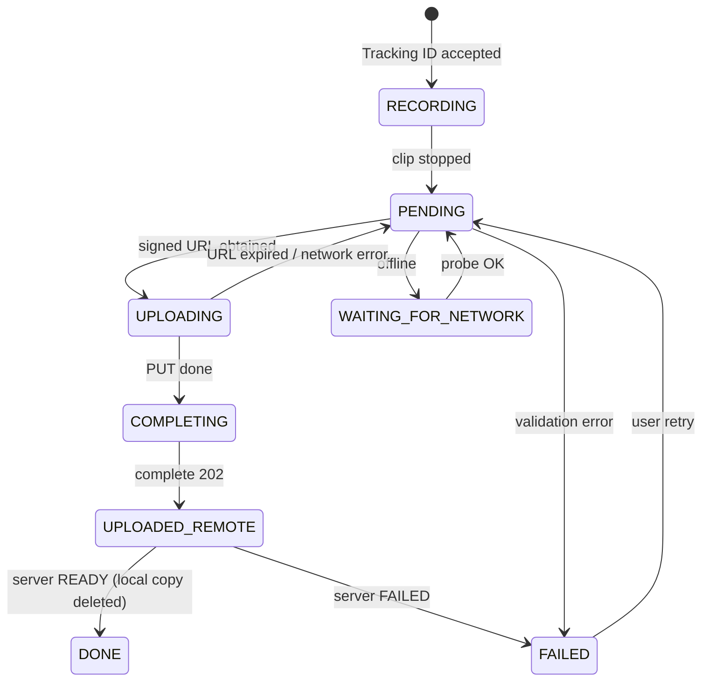
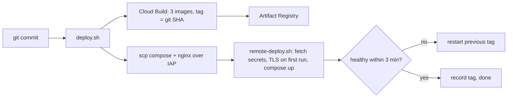

# 02 · High-level design

## Why each technology
| Technology | Role | Why |
| --- | --- | --- |
| React + TypeScript | Recorder UI, offline queue | `getUserMedia`, `MediaRecorder`, IndexedDB, Picture-in-Picture; types catch contract bugs |
| Spring Boot API | Auth, metadata, signing, orchestration | Mature security, transactions, Kafka; never touches video bytes |
| PostgreSQL | Metadata, outbox, attempt history | ACID makes "status + event" atomic |
| GCS | Video objects | Built for large binaries, private by default, signed URLs, conditional writes |
| Kafka | Async hand-off API ⇄ worker | Durable, replayable, retry topics + DLT, consumer groups |
| Watermark service | Background processing | CPU-heavy work isolated and scaled on its own |
| ffmpeg | Logo overlay | Industry-standard transcoding and overlays |
| Docker + GCE VM | Packaging + hosting | Same containers everywhere; cheapest setup that runs Kafka |

## Components


## End-to-end sequence
```mermaid
sequenceDiagram
  participant FE as React SPA
  participant API as api-service
  participant DB as Postgres
  participant GCS
  participant K as Kafka
  participant WM as watermark-service
  FE->>FE: Scan A → MediaRecorder.start(1000), chunks → IndexedDB
  FE->>FE: Scan B (or 2:00) → stop A, enqueue; B starts on the same stream
  FE->>API: POST /api/v1/videos (Idempotency-Key, trackingId, contentType, sizeBytes)
  API->>DB: insert video (UPLOADING, raw key)
  API->>API: V4-sign PUT via IAM signBlob (content-type + content-length-range, 15 min)
  API-->>FE: 201 {videoId, upload{url, headers, expiresAt}}
  FE->>GCS: PUT blob with the signed headers
  FE->>API: POST /videos/{id}/complete {durationMs}
  API->>GCS: stat raw (exists, size, type)
  API->>DB: TX: UPLOADED + outbox(video.uploaded.v1)
  API->>K: relay publishes (key = videoId)
  K->>WM: consume (attempt n)
  WM->>K: STARTED
  WM->>GCS: final exists? no → download raw
  WM->>WM: ffprobe → ffmpeg overlay → ffprobe verify
  WM->>GCS: create videos/{owner}/{id}.mp4 (ifGenerationMatch=0), delete raw
  WM->>K: COMPLETED {finalKey, size, duration}
  K->>API: attempt row + READY (idempotent)
  FE->>API: GET /videos (polls while pending), GET /videos/{id}/playback-url
```

## How pre-signed URLs work
1. The bucket is private and the browser has no GCP credentials. Routing 40 MB per clip through the API would waste its memory and bandwidth.
2. After Stop, the browser sends `POST /api/v1/videos` with `{trackingId, contentType, sizeBytes}`.
3. The API validates the JWT, the ID format, the content type and the size. It creates the video record and builds the object key itself (`raw/{owner}/{id}.webm`), never from user input.
4. The API builds a V4 canonical request: `PUT`, the object path, the signed headers `content-type` and `x-goog-content-length-range: 0,104857600`, and a 15-minute expiry. The request is hashed and signed by the VM's service account through the IAM **signBlob** API, so no private key ever leaves Google. The URL carries `X-Goog-Algorithm`, `X-Goog-Credential`, `X-Goog-Date`, `X-Goog-Expires`, `X-Goog-SignedHeaders` and `X-Goog-Signature`.
5. The browser sends `PUT` with exactly those headers. GCS recomputes the signature and rejects any other object, method, content type, a size outside the range, or an expired URL.
6. `/complete` doesn't trust the client: the API stats the object, then writes `UPLOADED` and the outbox row in **one transaction**.
7. Playback (`/playback-url`) signs a 5-minute GET for the watermarked MP4 only.

## Sync vs async: why Kafka
| | Synchronous HTTP to the worker | Kafka |
| --- | --- | --- |
| Caller waits for ffmpeg | Yes | No, returns 202 |
| Worker down | Uploads fail | Messages wait in the topic |
| Burst of uploads | Worker overloaded | Topic buffers, workers drain |
| Retries | Hand-written | Retry topics + DLT built in |

**How Kafka is used:**
- **Producer:** the outbox relay.
- **Topic:** `video.uploaded.v1` with 3 partitions, key = videoId (per-video ordering).
- **Consumers:** consumer group `watermark-service`; parallelism is at most the number of partitions.
- **Offsets:** committed after success or after a durable hand-off to a retry topic or the DLT. A crash causes redelivery, so the consumers are idempotent.

## How ffmpeg adds the watermark
The filter graph is `[1:v]scale=192:-2,format=rgba,colorchannelmixer=aa=0.85[logo];[0:v][logo]overlay=W-w-26:H-h-26:format=auto,…,format=yuv420p[out]`:
- The logo is scaled to 15% of the video width and set to 85% opacity.
- It's placed bottom-right with a margin proportional to the width.

Output settings:
- `libx264 -preset veryfast -crf 23` for H.264 video.
- AAC audio: Chrome records Opus, which plays unreliably inside MP4.
- `+faststart`, so playback can start immediately.

The command runs through `ProcessBuilder` as an argument list (no shell), with a 3-minute timeout and a forced kill. ffprobe checks the input before and the output after.

## Failure handling
| Situation | Behaviour |
| --- | --- |
| Network drops while recording | Recording continues; chunks are on disk |
| Network drops during upload | Backoff + jitter (1 s … 5 min); resumes when the probe succeeds |
| Wi-Fi without internet | Two failures, or a failed `/ping`, mean OFFLINE; ONLINE again only after a successful probe |
| Browser crash / refresh | Open recordings are closed with the bytes on disk and queued |
| Signed URL expired | 403 → a new URL is requested (idempotent POST) |
| Kafka down | Outbox rows wait; the relay retries every second |
| Transient processing error | RETRYING event, retry topics 10 s / 60 s / 300 s, then the DLT and FAILED |
| Corrupt / too long / too large | Straight to the DLT, FAILED with a code, raw kept for an admin |
| Duplicate event | Final exists, so the worker skips; API: processed-event table + state machine |
| Two workers, same video | Create-only write (`ifGenerationMatch=0`); the loser treats it as done |
| Result for an old run | Ignored (`run` number) |
| Bad deployment | Health checks fail → automatic rollback to the previous tag |

## Lifecycle state machines




## Deploy and rollback

