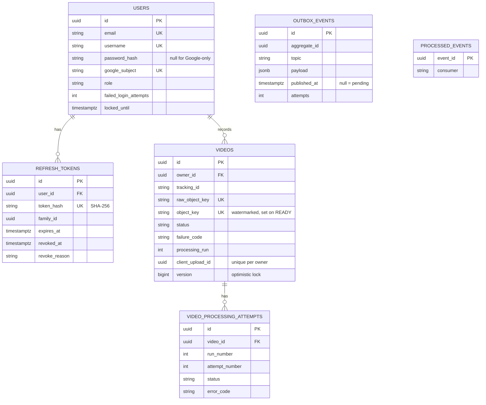

# 03 · Low-level design

## api-service (modular monolith, package-by-feature)
```
com.vms.api
├── common/   error (ErrorCode, ApiException, GlobalExceptionHandler → RFC 7807), web (RequestIdFilter,
│             PageResponse, PublicController: /config/public, /ping), config (RecordingProperties,
│             KafkaConfig: topics + DefaultErrorHandler → result DLT), security (SecurityConfig,
│             RefreshRequestGuardFilter, CurrentUser resolver, problem-JSON 401/403)
├── auth/     api (AuthController, DTOs, RefreshCookies) · application (AuthService, AccessTokenService,
│             RefreshTokenService, strategy/{Password,Google}AuthenticationStrategy + Resolver)
│             domain (User, RefreshToken, Role) · port (GoogleTokenVerifierPort)
│             infrastructure (JwtConfig: Nimbus HS256, GoogleIdTokenVerifierAdapter: JWKS, repositories,
│             DemoUserBootstrap)
├── video/    api (VideoController, DTOs) · application (VideoService, WatermarkResultHandler)
│             domain (Video aggregate, VideoStatus state machine, FailureCode, ProcessingAttempt,
│             TrackingId, ObjectKeys) · events (versioned contracts) · infrastructure (repositories,
│             VideoSpecifications, WatermarkResultListener)
├── storage/  StoragePort · gcs/GcsStorageAdapter · local/{LocalStorageAdapter, LocalUrlSigner,
│             LocalStorageController} · StorageConfig (Strategy by vms.storage.provider)
└── outbox/   OutboxEvent, OutboxRepository (FOR UPDATE SKIP LOCKED), OutboxService (MANDATORY tx),
              OutboxRelay (@Scheduled), ProcessedEvent(+Repository)
```

## watermark-service
```
com.vms.watermark
├── messaging/   VideoUploadedListener (@RetryableTopic 4 attempts, 10 s × 6 up to 300 s, exclude
│                NonRetryable, @DltHandler), WatermarkResultPublisher, WatermarkEvents
├── application/ AbstractVideoJob (Template Method), WatermarkJob, TempWorkspace, JobRequest/Result
├── processing/  VideoProcessor port, FfmpegVideoProcessor, FfmpegCommandBuilder (Builder),
│                FfprobeClient, ProcessRunner (argument list, timeout, destroyForcibly), MediaInfo
├── storage/     ObjectStoragePort, GcsObjectStorageAdapter (createIfAbsent = ifGenerationMatch 0),
│                LocalObjectStorageAdapter, StorageConfig
├── exception/   FailureCode, Retryable / NonRetryableProcessingException
└── health/      FfmpegHealthIndicator (binaries + logo present → readiness)
```

## frontend
```
src/
├── app/        App (router, header, error boundary), services.ts (composition root), ServicesContext
├── lib/        apiClient (in-memory token, single-flight refresh), errors, retryPolicy (Strategy), db (idb)
├── features/auth/          AuthContext, LoginPage, GoogleSignInButton
├── features/camera/        useCameraDevices, useMediaStream, cameraErrors
├── features/recorder/      recorderMachine (pure), recordingController, mediaRecorderFactory,
│                           TrackingIdInput, LivePreview (PiP), RecorderPage
├── features/uploads/       uploadJob (state machine), uploadJobRepository, uploadQueue,
│                           uploadTransport (port + SignedPutTransport), uploadsApi, UploadQueuePanel
├── features/connectivity/  connectivityMonitor (Observer), useConnectivity
└── features/videos/        videosApi, VideosPage
```

## Design patterns
| Pattern | Where | Benefit |
| --- | --- | --- |
| Ports & adapters | `StoragePort`, `ObjectStoragePort`, `GoogleTokenVerifierPort`, `VideoProcessor`, `UploadTransport`, `UploadsApi` | Business logic independent of GCS/ffmpeg/Google; local emulators; easy tests |
| Strategy | Auth strategies, storage provider, `RetryPolicy`, upload transport | Add a provider by adding a class |
| State machine | `VideoStatus`, `recorderMachine`, `uploadJob` | Duplicate or out-of-order events can't corrupt state |
| Template Method | `AbstractVideoJob.execute` | Idempotency check, ordering and cleanup can't be skipped |
| Builder | `FfmpegCommandBuilder` | Readable, testable, injection-safe commands |
| Factory | `AuthenticationStrategyResolver`, `mediaRecorderFactory` | Creation logic in one place |
| Observer | Connectivity monitor, upload-queue snapshots, Kafka events | Loose coupling |
| Transactional outbox + idempotent consumer | `outbox_events`, `processed_events`, create-only final object | Exactly-once effect over at-least-once delivery |
| Repository, DTO + mapper, Value Object | JPA repositories, `*Dtos`, `TrackingId` | Contracts decoupled from persistence; invariants in one place |

## Database

- **Indexes:**
  - `videos(owner_id, created_at desc)`, `videos(owner_id, tracking_id)`, `videos(status, created_at)`
  - unique `(owner_id, client_upload_id)`
  - unique `(video_id, run_number, attempt_number)`
  - partial `outbox_events(created_at) where published_at is null`
- **Ownership:** only the API writes Postgres. The watermark service reports through events, so it shares no schema.
- **Runs:** `processing_run` increments on every (re)queue. Results from an older run are ignored.

## Concurrency controls
| Risk | Control |
| --- | --- |
| Two tabs upload the same clip | Web Locks: one uploader per browser |
| A retried `POST /videos` creates duplicates | `Idempotency-Key` + unique `(owner_id, client_upload_id)` |
| Concurrent status updates | State machine + `@Version` optimistic locking (the listener retries on conflict) |
| Several API instances relay the outbox | `SELECT … FOR UPDATE SKIP LOCKED` |
| Redelivered or duplicate events | `processed_events`; attempt upsert; worker skips when the final object exists |
| Two workers on one video | Key = videoId (single partition) + create-only final write |
| Worker crash mid-job | Offset committed only after success or DLT hand-off; GCS upload is atomic; temp dir per job |
| Several tabs refresh the token at once | Single-flight per tab + 10 s rotation grace on the server |
| Fast scan, scan | Recorder commands run one after another in a promise chain |

## Event contracts (`docs/contracts`)
- **Envelope:** `{eventId, eventType, version, occurredAt, correlationId, payload}`. The Kafka key is `videoId`. The correlation id also travels in the `x-correlation-id` header.
- **`video.uploaded.v1`:** `{videoId, ownerId, trackingId, run, rawObjectKey, finalObjectKey, contentType, sizeBytes}`.
- **`video.watermark.result.v1`:** `{videoId, run, attempt, outcome: STARTED|RETRYING|COMPLETED|FAILED, finalObjectKey?, finalSizeBytes?, durationMs?, errorCode?, errorMessage?}`.
